# GodotF126 — Manual de usuario

**Simulador de Fórmula 1 · Temporada 2026**
Agustín Giménez · Materia 350 — Ingeniería de Software Avanzado

---

## 1. Cómo jugar

Hay tres formas, con el mismo juego:

| Forma | Qué hace falta | Cómo |
|---|---|---|
| **Ejecutable de Windows** (recomendada) | Windows 10/11 de 64 bits, placa de video con OpenGL 3.3 (sirve una Intel UHD integrada) | Doble clic en `GodotF126.exe`. Es un solo archivo de ~105 MB: se puede copiar a un pendrive o a cualquier carpeta. No se instala nada. |
| **En el navegador** | Chrome, Edge o Firefox actualizados, con WebGL 2 | Entrar a [ingsoftwareavanzado.agustingimenez.ar](https://ingsoftwareavanzado.agustingimenez.ar/), esperar la carga (~10 MB) y **hacer clic una vez sobre el juego** para que tome el teclado. |
| **Desde el editor de Godot** | Godot 4.7.2 (Standard) | Abrir `GodotF126/project.godot` y apretar **F5**. |

El juego corre siempre en tu PC (también en el navegador: el sitio sólo entrega los archivos). En el navegador es el mismo juego, pero más lento; por eso ahí arranca con calidad gráfica **Baja** (se puede subir en Opciones) y la carrera se corre con **10 autos** en lugar de 22. Para la grilla completa conviene el `.exe`. En el navegador no hay botón "Salir": se cierra la pestaña.

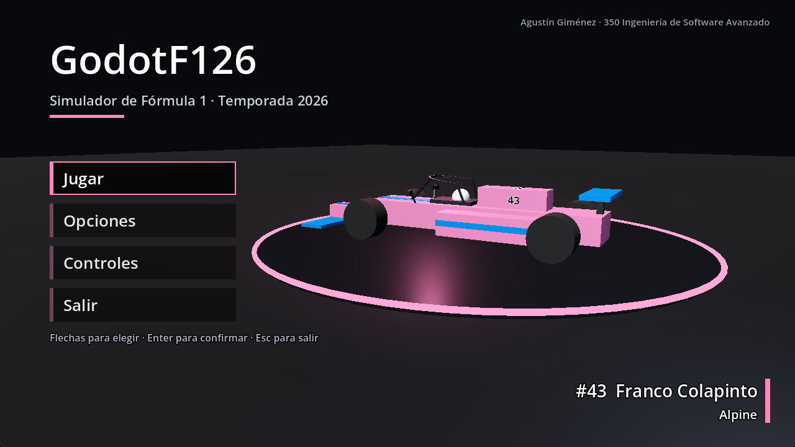

## 2. Menú principal

Se maneja con las **flechas** y **Enter** (o con el mouse). **Esc** vuelve atrás.

- **1 jugador**: elegir pista, clima y modo, después escudería y piloto.
- **Multijugador online**: carrera contra otra persona por internet (sección 2.3).
- **Desde el celular**: en la web, al entrar elegí "Celular" para manejar con controles en pantalla (sección 2.4).
- **Opciones**: ayudas, cámara, calidad gráfica, sonido y más (sección 6).
- **Controles**: tabla de teclas y asignación de teclado, mando o volante (sección 4).
- **Salir** (sólo en Windows).

### 2.1 Elegir modo

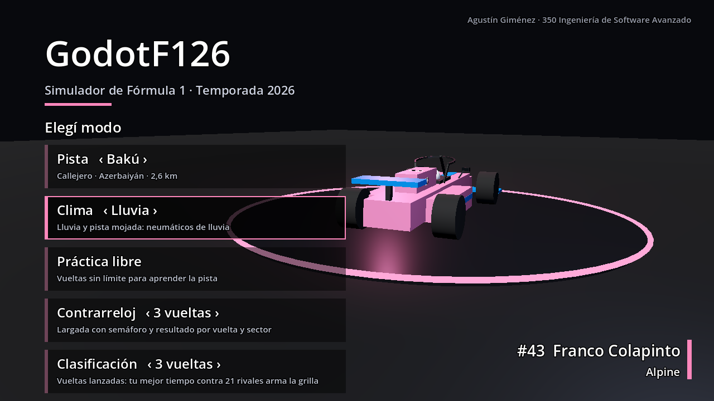

Las tarjetas de arriba se cambian con **← / →**:

- **Pista**: Bakú (Azerbaiyán, callejero de 2,6 km con el sector angosto del castillo) o el Autódromo de Buenos Aires (3,8 km). Las dos son trazados inventados inspirados en las reales, no los oficiales.
- **Clima**: Seco, Húmedo o Lluvia. Con agua hay menos agarre y aparecen los neumáticos intermedio y de lluvia.

Modos (las vueltas se eligen con ← / → sobre la tarjeta):

| Modo | Qué es |
|---|---|
| **Práctica libre** | Vueltas sin límite para aprender la pista. Se puede cambiar el setup en la pausa y sumar rivales de la IA con **I**. |
| **Contrarreloj** (1–10 vueltas) | Largada detenida con semáforo; al final, tiempos por vuelta y por sector. |
| **Clasificación** (1–5 vueltas) | Vueltas lanzadas; tu mejor tiempo contra los 21 rivales arma la grilla. Desde el resultado se pasa a la carrera. |
| **Carrera** (2–20 vueltas) | Grilla 2026 completa (22 autos), largada con semáforo, torre de tiempos, boxes, banderas y comisarios. |
| **Campeonato** (2–10 vueltas) | Temporada de 2 fechas (Bakú y Buenos Aires) con el mismo piloto: clasificación y carrera en cada una, tablas de pilotos y constructores. Se guarda sola y se sigue desde el menú ("Seguir: fecha 2/2"). |

En la misma lista están **Neumáticos ‹ … ›** (el compuesto con el que se sale, con ← / →) y **Setup del auto** (sección 7).

### 2.2 Escudería y piloto

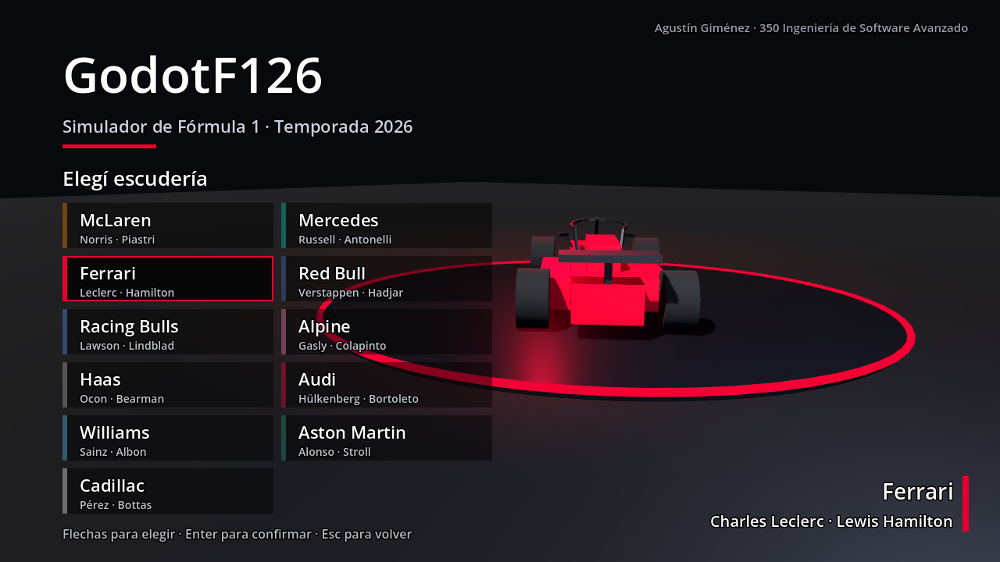

Primero la escudería (11 equipos de 2026) y después el piloto (22). El auto del menú toma los colores del equipo. Después aparece la **pantalla de carga** con los controles y un consejo; la primera vez espera **Enter** para que se lean.

### 2.3 Multijugador online (2 jugadores)

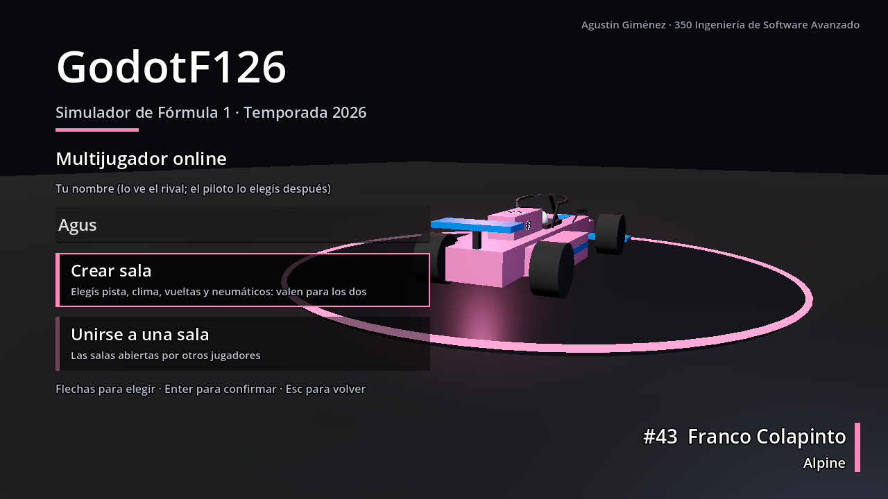

1. **Tu nombre**: escribilo arriba (hasta 16 letras). Es lo que ve el otro jugador; el piloto se elige después y puede ser cualquiera. Si lo dejás vacío, jugás como "Jugador" con un número.
2. Uno elige **Crear sala**: pista, clima, vueltas (1, 2, 3 o 5) y neumáticos, Enter, y después escudería y piloto. La pantalla de carga dice "Sala creada · esperando a que alguien se una…".
3. El otro elige **Unirse a una sala**: aparece la lista de salas abiertas (se actualiza sola), con quién la creó, la pista, las vueltas, el clima y los neumáticos. Enter en una sala, escudería y piloto.

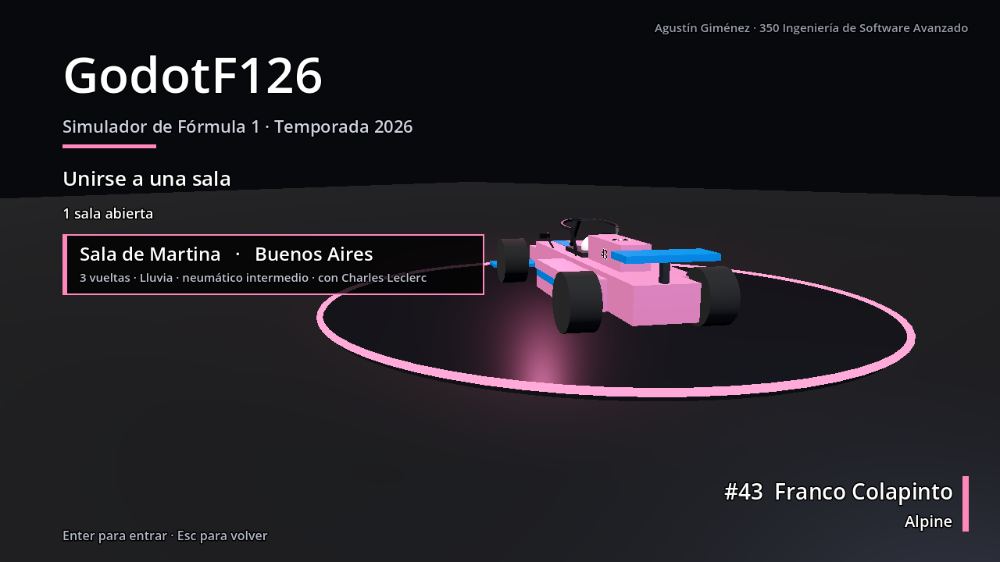

- **Las mismas reglas para los dos**: pista, vueltas, clima y neumáticos son los de la sala, y los dos autos usan el setup base (no el que cada uno guardó).
- **Largada**: los dos autos en la grilla (el que creó la sala adelante). **Mientras el semáforo está en rojo los autos están bloqueados**: no se puede salir antes. Las luces se apagan a la vez en las dos PCs: el semáforo arranca recién cuando los dos ya están viendo la pista y sigue un reloj común, así que una PC más lenta no larga atrasada.
- **En carrera** el otro auto choca de verdad. Arriba a la izquierda se ve "ONLINE · vas 1.º / 2.º" y la distancia en segundos. **Esc no detiene la carrera** (el otro sigue corriendo) y R vuelve a la pista.
- **Resultado**: por tiempo total (vueltas + penalizaciones), con el nombre y el piloto de cada uno. Si el otro todavía no llegó, se lo espera hasta un minuto. "Repetir" vuelve a las salas. Si el otro se desconecta, seguís solo.
- Se puede jugar entre el navegador y el `.exe`. Hace falta internet; Esc en la pantalla de carga cancela y vuelve a las salas.

### 2.4 Jugar desde el celular (versión web)

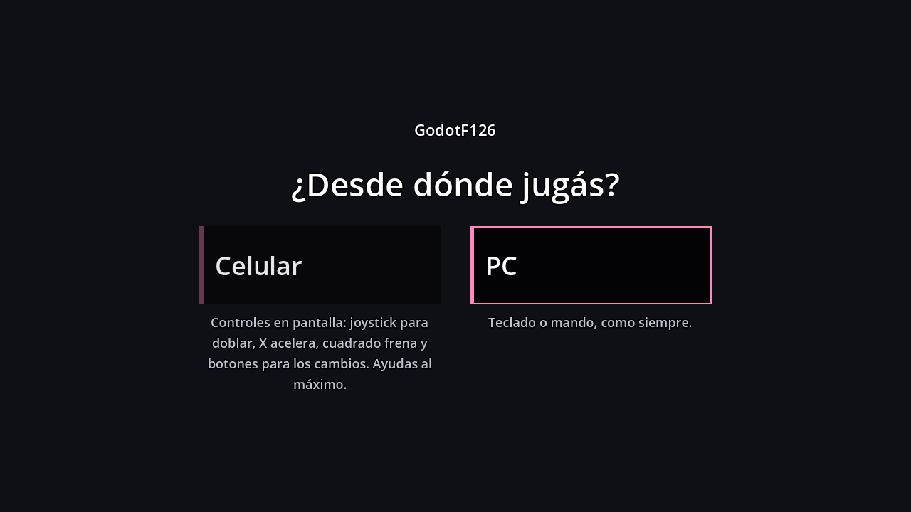

Al entrar a la web se elige **Celular** o **PC**. Con PC se juega como siempre (teclado, mando y mouse). Con Celular, con el teléfono acostado:

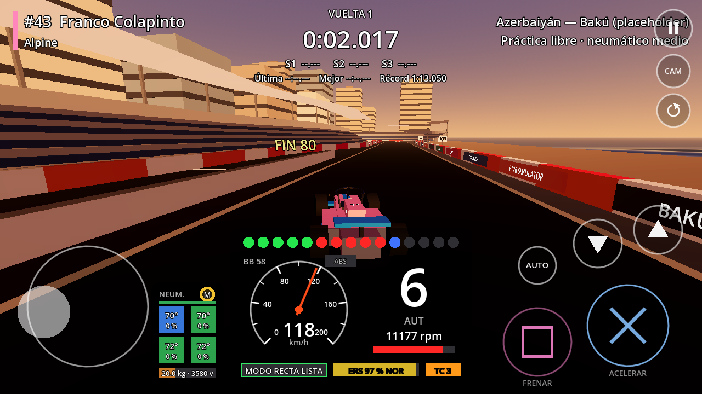

- **Joystick a la izquierda** para doblar (apoyá el pulgar donde quieras de ese lado).
- **X acelera** y **cuadrado frena**, como en un mando de PlayStation; se puede deslizar el dedo de uno al otro.
- **▲ / ▼** suben y bajan los cambios (si la caja estaba en automática pasa a manual); **AUTO / MAN** cambia la caja.
- Arriba a la derecha: **pausa**, **CAM** (cámara) y **volver a la pista**.
- En los menús, **← Volver** arriba a la derecha hace de Esc, y las vueltas de un modo se cambian tocando a la derecha de su tarjeta.
- La primera vez quedan todas las ayudas al máximo (caja automática, ABS, control de tracción 3, dirección asistida, calidad Baja); se pueden cambiar en Opciones. La carrera es de 6 autos para que vaya fluida.

## 3. En pista

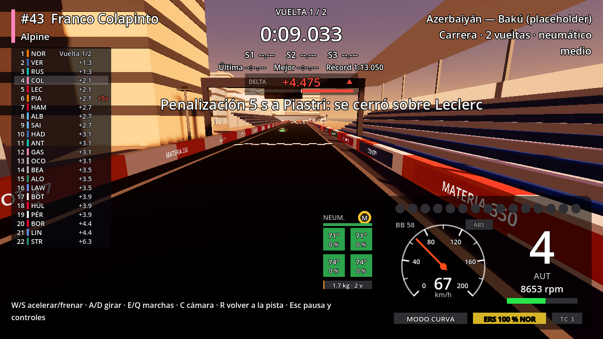

### 3.1 Lo que se ve

- **Arriba al centro**: cronómetro de la vuelta, sectores (S1, S2, S3), última y mejor vuelta y récord de la pista. Debajo, el **delta** contra tu mejor vuelta (verde, ganás tiempo; rojo, perdés).
- **Abajo a la derecha, el tablero**: luces de cambio, marcha (R, N, 1–8), RPM, velocímetro con aguja, modo de la aerodinámica (RECTA / CURVA), batería del ERS y nivel del control de tracción. Arriba del velocímetro, el reparto de frenada ("BB 58") y la luz del ABS.
- **A la izquierda del tablero**: neumáticos (compuesto, temperatura y desgaste de cada rueda), combustible, y la salud del alerón delantero.
- **En carrera**: la **torre de tiempos** a la izquierda (posición, compuesto, diferencia, penalizaciones), la franja de **banderas** arriba (amarilla, azul, Safety Car) y los mensajes de **radio del ingeniero** arriba a la derecha.
- **F3**: panel de cargas por rueda, deslizamiento, temperaturas, alturas, aerodinámica, frenos, ERS y combustible.

### 3.2 Reglas que importan

- **Límites de pista**: con las cuatro ruedas fuera de los pianos la vuelta queda **inválida** (no cuenta para la mejor vuelta ni el récord).
- **Largada detenida**: moverse antes de que se apaguen las cinco luces es salto en falso (+5 s).
- **Daños**: un golpe fuerte de trompa rompe el alerón (menos carga adelante); un golpe cerca de una rueda la pincha. En práctica, **R** repara; en carrera hay que entrar a boxes.
- **Boxes** (carrera): la calle tiene límite de 80 km/h (**P** prende el limitador; pasarse son +5 s). En el box el auto se detiene solo y se cambian neumáticos y alerón. **O** elige el compuesto de la parada.
- **Estrategia**: en carreras de 10 o 20 vueltas en seco hay que usar **dos compuestos** (si no, +30 s). El ingeniero avisa por radio cuándo parar ("Box, box").
- **Banderas y comisarios**: con amarilla no se puede pasar; con azul hay que dejar pasar al que te saca una vuelta; con Safety Car se forma la fila detrás y nadie pasa. Los toques se juzgan y pueden dar advertencias o +5 s.

### 3.3 Pausa (Esc)

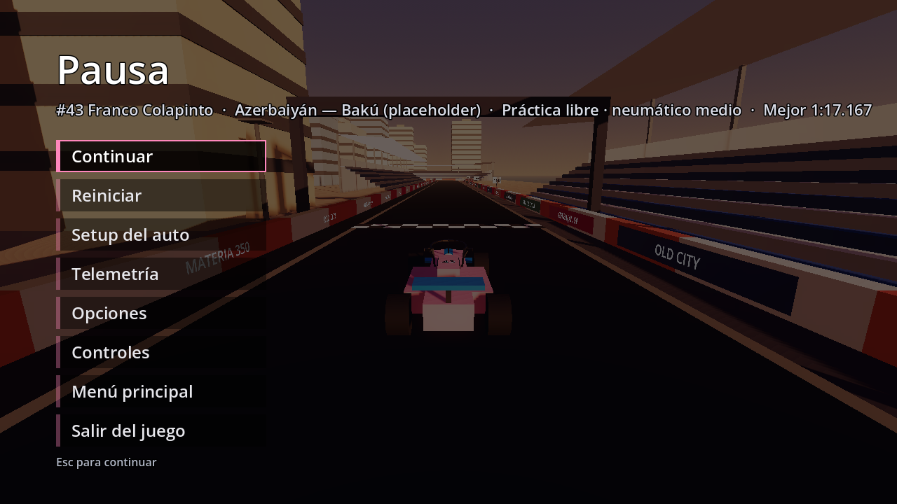

Continuar · Repetición (en carrera) · Reiniciar · Setup del auto (en práctica) · Telemetría · Opciones · Controles · Menú principal · Salir del juego (sólo en Windows).

### 3.4 Resultado

Al terminar aparecen los tiempos (contrarreloj) o la clasificación final con puntos (carrera). Las vistas (clasificación, puntos, equipos, sanciones y, en campeonato, campeonato y constructores) se cambian con el botón **Ver …** o con **← / →**. Botones: **Ver repetición**, **Repetir**, **Menú principal** y, en campeonato, **Siguiente**.

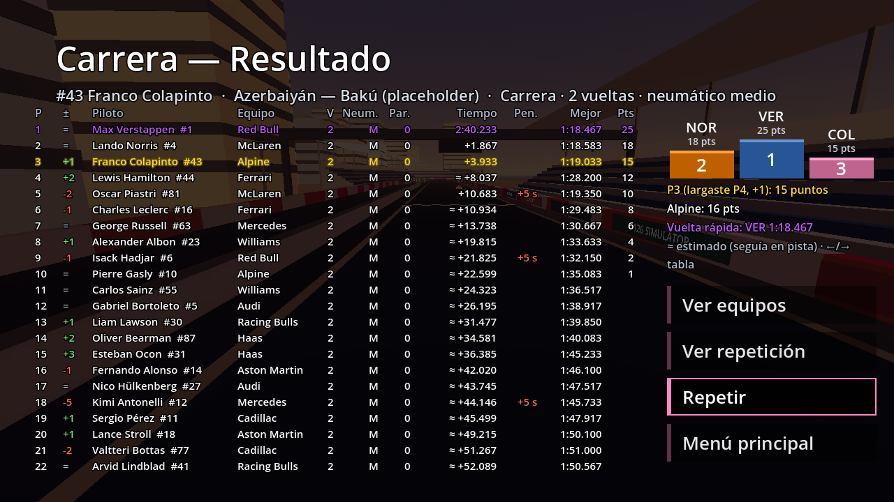

## 4. Controles

### 4.1 Teclado

| Acción | Tecla |
|---|---|
| Acelerar / frenar | **W** / **S** (o ↑ / ↓) |
| Girar | **A** / **D** (o ← / →) |
| Freno de mano | **Espacio** |
| Subir / bajar marcha | **E** / **Q** (con el auto quieto, Q pone N y después R) |
| Caja manual / automática | **M** |
| Modo recta (si está en manual) / modo adelantamiento | **F** / **G** |
| Reparto de frenada más atrás / más adelante | **Z** / **X** |
| Control de tracción (0 → 3) / modo del ERS | **T** / **V** |
| Cambiar cámara (6 vistas) / panel de cargas | **C** / **F3** |
| Volver a la pista / limitador de boxes / compuesto de la parada | **R** / **P** / **O** |
| Línea de trazada (completa → sólo frenadas → apagada) / auto fantasma / rival IA en práctica | **L** / **H** / **I** |
| Pausa | **Esc** |

### 4.2 Mando (distribución Xbox)

Gatillo derecho acelera y el izquierdo frena (de a poco), palanca izquierda dobla, **RB / LB** suben y bajan marcha, **A** modo adelantamiento, **X** modo recta, **Y** cámara, **B** limitador, **Back** volver a la pista, cruceta ↑ ERS, ↓ control de tracción, ← / → reparto de frenada, **L3** freno de mano, **R3** panel de cargas, **Start** pausa. El mando vibra con golpes, pianos, ABS y deslizamiento.

### 4.3 Cambiar los controles

**Controles → Asignar controles**: elegir la acción, apretar la tecla, botón o eje nuevo (Esc cancela, Supr borra). Ahí también se ajustan el recorrido de los pedales (con un volante: "Volante (−1 a 1)"), la zona muerta y la curva de la dirección y la vibración. Se guarda solo.

## 5. Manejar rápido

- **Velocidades como una F1**: 0–100 km/h en unos 2,5 s y 0–300 en unos 11 s. Cada marcha llega más o menos a 100 / 135 / 170 / 205 / 240 / 275 / 312 / 350 km/h; en las rectas largas, con los alerones abiertos, se pasan los 350.

- Los carteles **150 · 100 · 50** antes de cada curva marcan dónde frenar. La **línea de trazada** (L) se pone amarilla donde hay que levantar y roja donde hay que frenar.
- **Aerodinámica activa**: en las rectas los alerones se abren (menos arrastre) y se cierran al frenar. **G** suma potencia con energía limitada por vuelta, sólo a menos de 1 s del de adelante.
- **ERS** (V): Ataque gasta la batería rápido; Recarga la llena al levantar y al frenar.
- **Neumáticos**: blando (más agarre, se gasta rápido), medio y duro. Agarran mejor dentro de su temperatura (cuadros verdes); azul es frío, rojo pasado.
- **Sin ABS** frenar a fondo bloquea las ruedas: el auto frena menos y no dobla. **Con poco control de tracción**, dosificá el acelerador al salir de las curvas lentas.
- El **auto fantasma** (H) repite tu mejor vuelta: donde se escapa, ahí perdés tiempo.

## 6. Opciones

Caja de cambios (manual / automática) · Dirección asistida · Modo recta (automático / manual) · ABS · Control de tracción (no, 1–3) · Cámara inicial (TV, Cercana, Cockpit, T-cam, Capot, De pista) · Calidad gráfica (Baja, Media, Alta) · Hora de la carrera (Atardecer, Día) · Nivel de la IA (Fácil, Medio, Difícil, Experto) · Pantalla completa · Volúmenes (general, motor, efectos, música). **Restablecer** vuelve a los valores de fábrica (sin tocar los controles). Todo se guarda solo.

Si el juego va lento, bajar la **Calidad gráfica** a Media o Baja.

## 7. Setup del auto

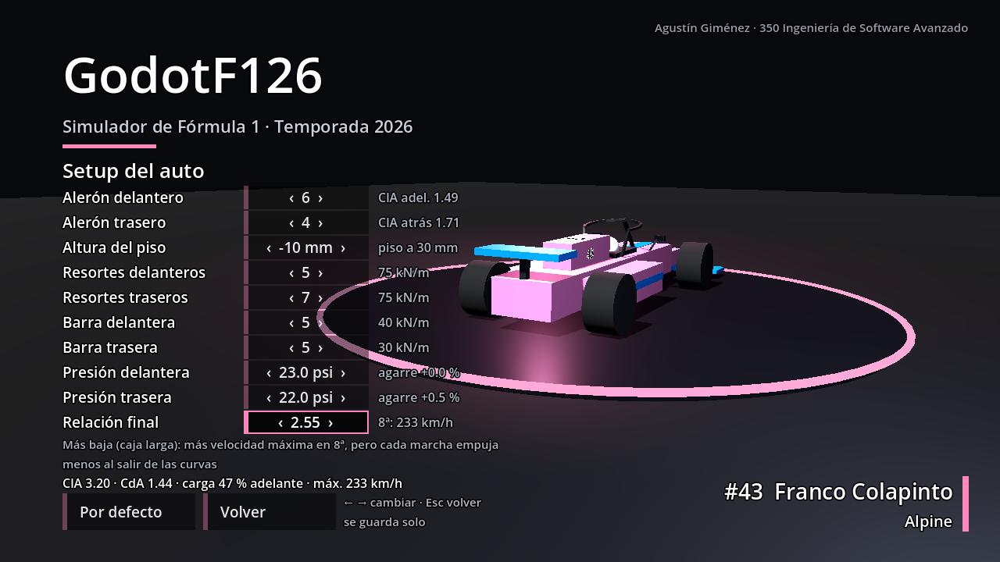

Alerones delantero y trasero, altura, resortes, barras estabilizadoras, presiones y relación final. A la derecha se ve qué cambia (carga, arrastre, reparto, velocidad máxima). Más alerón: más agarre en curva y menos velocidad en recta; muy bajo, el piso toca y pierde carga. **Por defecto** vuelve al setup base. Se edita desde el menú de modos o, en práctica, desde la pausa.

## 8. Telemetría

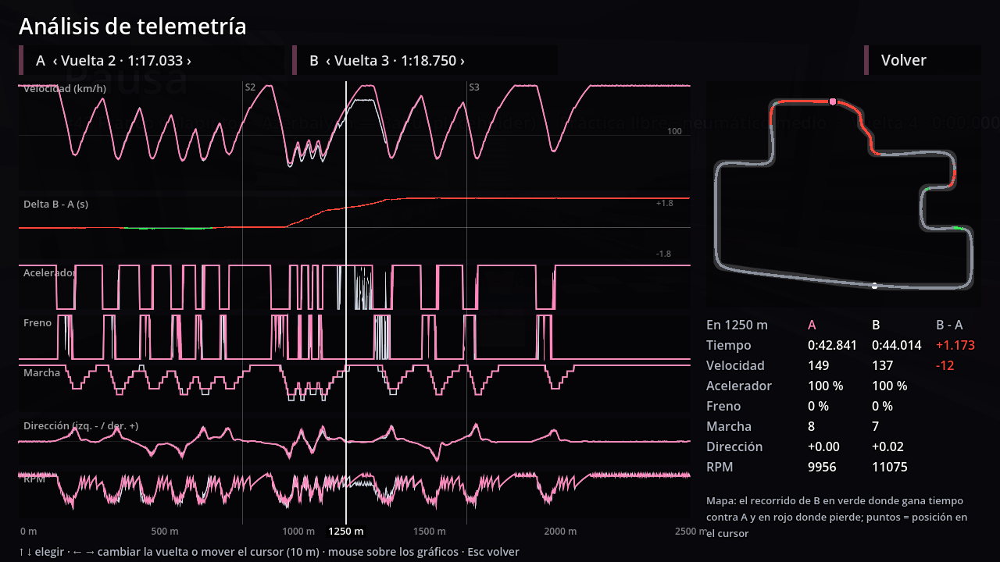

En la pausa, **Telemetría** muestra las últimas vueltas y la velocidad de la última contra la mejor. **Análisis** compara dos vueltas (A y B) en gráficos de velocidad, delta, acelerador, freno, marcha, dirección y RPM, con un mapa de la pista que pinta dónde se gana y dónde se pierde. Con **CSV A y B** o **CSV todas** se exportan para abrir en Excel.

## 9. Repeticiones

Desde la pausa (en carrera) o desde el resultado, **Ver repetición**:

Espacio pausa · ← / → atrás y adelante · flechas ↑ / ↓ velocidad · **C** cámara (persecución, a bordo, TV) · **Q / E** cambia de auto · **I** salta al próximo incidente · Inicio vuelve a la largada · Esc sale.

## 10. Dónde se guardan los datos

En Windows: `%APPDATA%\Godot\app_userdata\GodotF126\` (récords, opciones, controles, setup, mejor vuelta para el fantasma, temporada del campeonato, CSV exportados en `telemetria\`). En el navegador se guardan en el propio navegador. Borrar esa carpeta deja el juego como nuevo.

## 11. Prueba de rendimiento

`GodotF126.exe -- --benchmark` (desde una consola en la carpeta del `.exe`) mide la pista con las tres calidades y recomienda la más alta que se sostiene a 60 FPS. El informe queda en `benchmark.txt`, en la carpeta de datos.

## 12. Problemas comunes

| Problema | Solución |
|---|---|
| Va lento | Bajar la calidad gráfica; cerrar otros programas; en el navegador, preferir el `.exe` para la carrera de 22. |
| Las teclas no responden en el navegador | Hacer clic una vez sobre el juego. |
| El auto quedó cruzado o atascado | **R** lo devuelve a la pista. |
| La vuelta no cuenta | Se salió de los límites (cuatro ruedas fuera): aparece "VUELTA INVALIDADA" con el motivo. |
| El auto no avanza al acelerar quieto | Está en N o en R: subir marcha con **E** (o pasar a automática con **M**). |
| Windows avisa "aplicación desconocida" | El `.exe` no está firmado: "Más información" → "Ejecutar de todas formas". |
